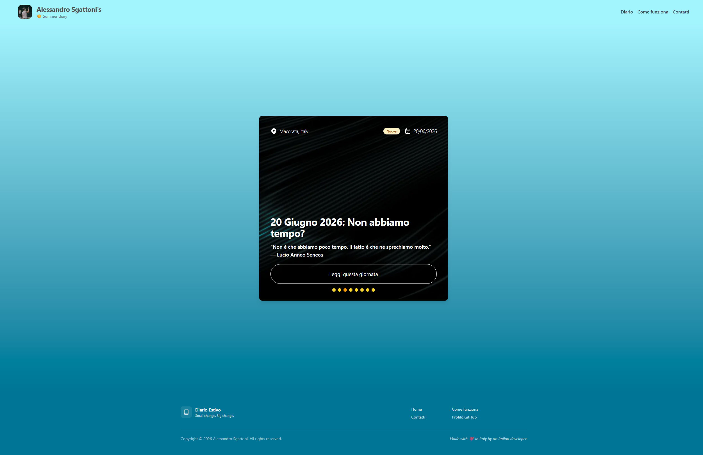

# Summer Diary 2026

A personal online diary of summer 2026, written in Italian: one animated page per day, with photos, audio and the place where it happened. This digital diary is paired with a physical diary which I personally wrote every single day of this past summer. Its main goal is to extend the experience of the physical diary with songs, images and other experiences I went through.

## Why did I build it?
Have you ever felt that feeling, at the end of the summer, when you just can’t move on to fall? But as Richard Feynman reminds us, “What is a memory? It is a memory of a past moment, a remembered feeling, an echo of a time. But a memory is also a feeling that can be remade. It is a new moment, a new feeling, a new memory, when you choose to recall the past.”

So this is my way to keep the memories of this past summer: a Next.js application that acts as an extension to the physical diary I wrote to handle media, knowledge and experience sharing.



### 👉 **[Read the diary](https://diary.sgattix.online)** 👈

## Quick start

Just open the link above. There's nothing to install. Start from the carousel on the home page, or go to **Diario** to see every day.

## Features

- **80 diary entries**, one page per day, each with a title, date, location cover image and songs.
- **Featured-days carousel** on the home page, showing the entries marked as highlights.
- **Full diary index** (`/diary`), sorted newest first, with dates and tags.
- **Photo galleries and audio clips** inside entries, with a modal image viewer and a built-in audio player.
- **Animated WebGL backgrounds** (silk, light rays, particles, threads…) and scroll animations, so each day has its own look using React Bits.
- **Reading progress tracker** and "next day" card to move from one entry to the next.

My favorite day is [the 18th of July](https://diary.sgattix.online/days/day-31), because it contains one of my favorite quotes ever:

> "Il curioso paradosso è che quando mi accetto così come sono, allora posso cambiare." — Carl Rogers

Which translates to:
> "The curious paradox is that when I accept myself just as I am, then I can change." — Carl Rogers

## How I made it

It took the whole summer. In most cases I wrote the page on the same day, but sometimes I had to catch up later.

## Local setup

Requirements:

- **Node.js 20+** and **npm** (the repo ships a `package-lock.json`)
- No database, no environment variables, no system dependencies

```bash
git clone https://github.com/Sgattix/summer-diary-2026.git
cd summer-diary-2026
npm install
npm run dev
```

Then open [http://localhost:2030](http://localhost:2030). Note that the dev server runs on port **2030**, not 3000.

For a production build: `npm run build && npm start`.

### Adding a new day

1. Create a folder `src/app/(subpages)/days/day-N/`.
2. Add a `page.tsx` (copy an existing day as a template) and a `meta.json`:

   ```json
   {
     "id": "day-81",
     "title": "7 Settembre 2026: ...",
     "description": "...",
     "date": "2026-09-07T00:00:00.000Z",
     "location": "Macerata, Italia",
     "featured": false,
     "tags": ["reflection"],
     "imageUrl": "https://...",
     "route": "/days/day-81"
   }
   ```

3. Put the day's photos and audio in `public/media/<DD-MM-YYYY>/`.

The day will show up in the diary index automatically, and on the home page too if `featured` is `true`.

## How it works

The project is built with **Next.js 15 (App Router)**, **React 19**, **TypeScript** and **Tailwind CSS 4**. There's no CMS or database: **the file system is the database**. Each day is its own route folder holding a hand-written `page.tsx` and a `meta.json`. The API routes in `src/app/api/days/` read those `meta.json` files at request time to build the full index (`/api/days`), the featured list (`/api/days/featured`) and the per-day metadata and image lists. 

I made each day a hand-written page on purpose: I didn't want to trade flexibility for scalability, and at the time I thought it was the best option. The hardest part was making up for the scalability issue with `meta.json`, so that I could have a highly customizable page without giving away too much scalability. To add a day I just needed to copy-paste a folder and call it a day.

The visual effects (Silk, DarkVeil, LightRays, Particles, Threads, Beams) are WebGL shaders rendered with **three.js / React Three Fiber** and **OGL**. Scroll-driven motion uses **GSAP**, **Motion** and **Lenis** for smooth scrolling.

## Credits

- [Next.js](https://nextjs.org), [React](https://react.dev), [Tailwind CSS](https://tailwindcss.com)
- [React Bits](https://reactbits.dev) and [Magic UI](https://magicui.design) for the animated background and text components
- [shadcn/ui](https://ui.shadcn.com) and [Radix](https://www.radix-ui.com) for UI primitives
- [Tabler Icons](https://tabler.io/icons) and [Lucide](https://lucide.dev)
- [re-audio](https://www.npmjs.com/package/@sina_byn/re-audio) for the audio player
- Cover photos from [Unsplash](https://unsplash.com)
